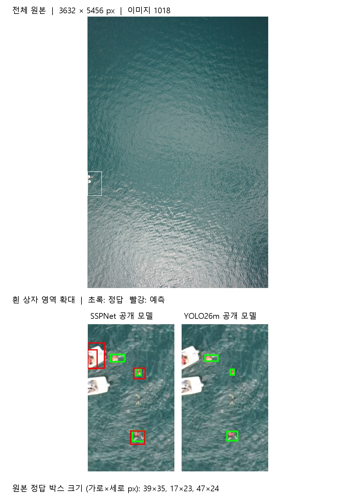
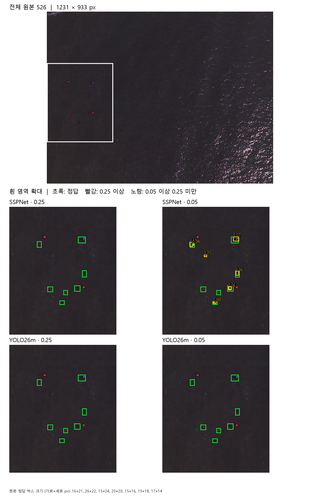
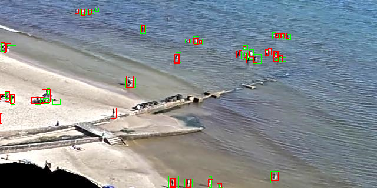
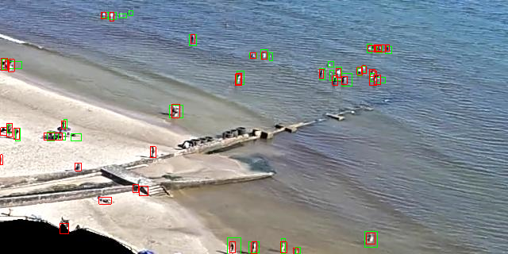
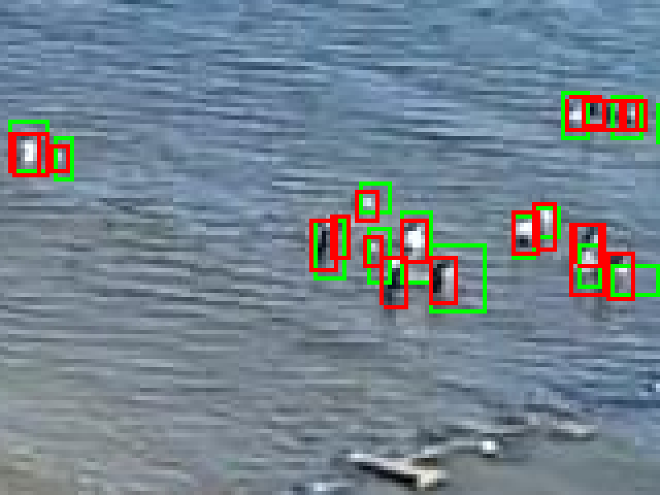
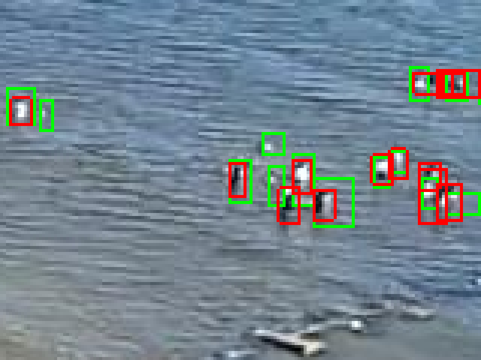
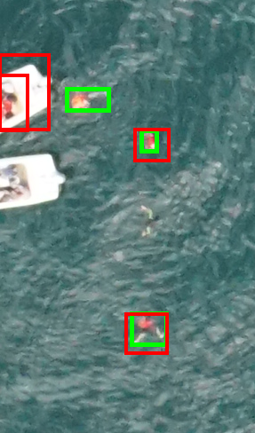
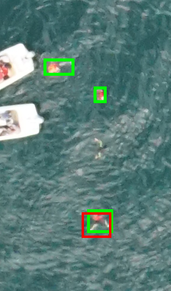
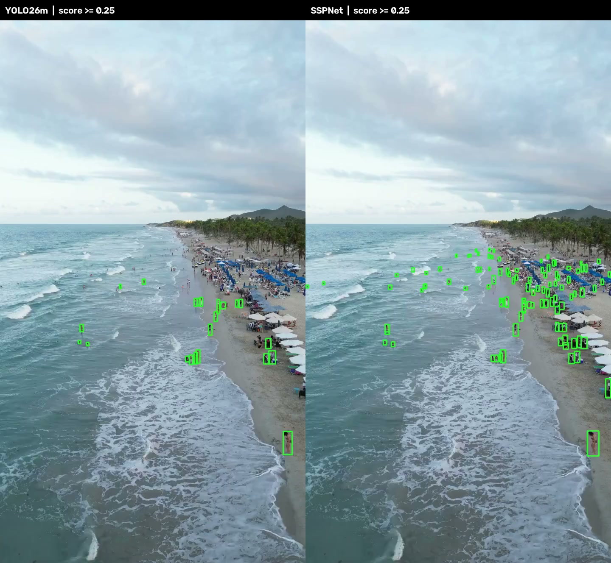
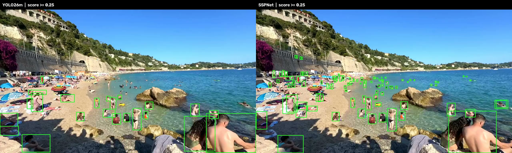

# 해안 미세 사람 탐지: 모델 비교와 추가 학습 효과 분석

해변·해상 영상에서 작은 사람을 놓치지 않으려면 어떤 탐지 모델과 추론 설정이 적합할까? **SSPNet과 YOLO26m의 공개 모델을 비교하고, SSPNet의 해변 데이터 추가 학습과 분할 추론이 탐지 성능에 미치는 영향을 평가했다.**

**핵심 결과:** SeaDronesSee의 작은 사람 정답 339개에 대한 재현율은 **SSPNet 67.0%, YOLO26m 15.3%였다.** 해변 추가 학습으로 AnnotationPiriapolis의 정밀도는 **11.1%에서 70.5%로 높아졌지만**, SeaDronesSee의 재현율은 **78.0%에서 64.0%로 낮아졌다.** 모델 선택에는 작은 객체 재현율, 오탐 부담, 평가 환경을 함께 고려해야 했다.



*SeaDronesSee 이미지 1018. 원본 전체 화면과 같은 영역의 확대 비교. 초록은 swimmer 정답, 빨강은 신뢰도 0.25 이상 예측이다. 개별 이미지는 시각적 예시이며 성능은 전체 평가 집합으로 계산했다.*

## 수행한 작업

- 공개 SSPNet의 Colab·로컬 GPU 실행 환경 구성과 가중치 로드·추론 코드 구현
- COCO 형식 주석 처리, 클래스 통합, 정답당 예측 하나를 인정하는 공통 평가 코드 구현
- 전체 이미지·분할 추론, 객체 크기별 재현율, 신뢰도별 정밀도·오탐 분석
- YoloBeachTrain v2를 이용한 SSPNet 5 epoch 추가 학습과 두 외부 데이터셋 평가
- 학습·평가 데이터 중복 점검, 오탐·미탐 사례 검토, 비교 이미지·영상 제작

SSPNet과 YOLO26m은 기존 공개 모델을 사용했다. 프로젝트의 기여는 실행·학습·평가 파이프라인과 실험 분석에 있다. 아래 내용은 완료한 실험을 질문별로 정리한 것이다.

## 1. 해안의 작은 사람 탐지에는 어떤 공개 모델이 적합할까?

### 평가 조건

| 항목 | 조건 |
|---|---|
| 데이터 | SeaDronesSee OD v2 validation 전체 1,547장 |
| 정답 | swimmer 6,206개 |
| 모델 | TinyPerson 학습 SSPNet Faster R-CNN R50 / COCO 학습 YOLO26m |
| 추가 학습 | 두 공개 모델 모두 없음 |
| 추론 | 전체 이미지, 최대 탐지 수 500 |
| 신뢰도 | 0.25와 0.05를 각각 평가 |
| 정답 판정 | IoU ≥ 0.3, 정답 하나당 예측 하나만 정탐으로 인정 |
| 실행 장치 | NVIDIA GeForce GTX 1660 Ti with Max-Q Design |

같은 이미지·정답·평가 함수를 사용했다. 신뢰도는 모델의 예측 점수로, 같은 숫자가 두 모델에서 동일한 확률을 의미하지는 않는다. 입력 처리와 후처리에도 차이가 있다. SSPNet은 PyTorch/CUDA, YOLO26m은 ONNX Runtime/DirectML로 실행했다.

### 전체 swimmer 성능

| 공개 모델 | 신뢰도 | 정탐 TP | 재현율 | 정밀도 | 이미지당 FP |
|---|---:|---:|---:|---:|---:|
| SSPNet | 0.25 | 4,839 | **78.0%** | 44.7% | 3.9 |
| YOLO26m | 0.25 | 3,186 | 51.3% | **66.1%** | **1.1** |
| SSPNet | 0.05 | 5,601 | **90.3%** | 15.2% | 20.2 |
| YOLO26m | 0.05 | 4,587 | 73.9% | **42.6%** | **4.0** |

두 신뢰도에서 SSPNet은 사람을 더 많이 찾았고, YOLO26m은 오탐이 적고 정밀도가 높았다. **작은 사람을 놓치지 않는 목표에서는 SSPNet이 유리했지만, 오탐까지 고려하면 모델별 장단점이 달랐다.**

### 작은 객체만 따로 평가하면?

크기는 원본 배포 이미지의 정답 박스에서 `s = √(가로 × 세로)`로 계산했다. `2 ≤ s < 20`픽셀 정답 339개를 평가했으며, 신뢰도는 0.25다.

| 공개 모델 | 작은 정답 수 | 작은 정답 정탐 수 | 작은 객체 재현율 |
|---|---:|---:|---:|
| SSPNet | 339 | 227 | **67.0%** |
| YOLO26m | 339 | 52 | 15.3% |

크기별 성능을 확인했을 때 모델의 차이가 더 뚜렷했다. TinyPerson과 COCO의 학습 데이터 차이가 영향을 주었을 가능성이 있지만, 이번 실험만으로 원인을 분리해 확정할 수는 없다.

<details>
<summary>작은 사람과 신뢰도 변화 비교 이미지</summary>



SeaDronesSee 이미지 526. 초록은 정답, 빨강은 신뢰도 0.25 이상, 노랑은 0.05 이상 0.25 미만 예측이다. 두 모델·두 신뢰도를 같은 영역에서 비교했다.

</details>

## 2. SSPNet을 해변 데이터로 추가 학습하면 개선될까?

### 추가 학습 설정

| 항목 | 설정 |
|---|---|
| 시작 가중치 | TinyPerson 학습 SSPNet 공개 가중치 |
| 학습 데이터 | YoloBeachTrain v2, 총 2,961장, 증강본 포함 |
| 사용 분할 | train 2,592장 + valid 247장 + test 122장 전체를 학습에 사용 |
| 클래스 | person water와 person sand를 person 하나로 통합 |
| 학습 | 5 epoch, batch size 1, SGD, 고정 학습률 0.0001, seed 0 |
| 추가 증강 | 별도 무작위 뒤집기 등 추가 증강 없음. 배포 데이터의 증강본은 포함 |
| 학습 장치 | Google Colab Tesla T4 |
| 평가 가중치 | 최종 epoch 5 체크포인트 |

배포본의 모든 분할을 학습용으로 합쳤으므로 YoloBeachTrain의 valid·test에 대한 독립 검증 성능을 주장하지 않는다. AnnotationPiriapolis와의 사전 중복 점검에서는 동일 이미지·장면이 발견되지 않아 외부 평가에 사용했다.

### AnnotationPiriapolis v4: 전체 사람 평가

학습과 별도인 해변 고정 카메라 이미지 **635장**, 물속·모래사장 사람 정답 **8,099개**를 평가했다. 배포본의 train 537장·valid 65장·test 33장을 합친 범위이며, test 33장만의 결과와 구분한다. 신뢰도 0.25, 매칭 IoU 0.3 기준이다.

| SSPNet | 추론 | TP | FN | FP | 재현율 | 정밀도 | 이미지당 FP |
|---|---|---:|---:|---:|---:|---:|---:|
| 공개 | 전체 | 1,765 | 6,334 | 14,163 | 21.8% | 11.1% | 22.3 |
| 공개 | 분할 | 1,864 | 6,235 | 34,097 | 23.0% | 5.2% | 53.7 |
| 추가 학습 | 전체 | 1,985 | 6,114 | **831** | 24.5% | **70.5%** | **1.3** |
| 추가 학습 | 분할 | **2,562** | **5,537** | 3,172 | **31.6%** | 44.7% | 5.0 |

전체 이미지 추론에서 추가 학습 모델은 공개 모델보다 TP가 220개 많고 FP가 13,332개 적었다. 분할 추론은 추가 학습 모델의 재현율을 24.5%에서 31.6%로 높였으나 FP도 831개에서 3,172개로 늘렸다.

**이번 해변 평가에서는 추가 학습 후 재현율·정밀도가 함께 개선됐다. 분할 추론은 재현율과 오탐 사이의 절충이었다.** 공개 모델의 분할 추론은 정탐 증가에 비해 오탐 증가가 컸으며, 배포본 valid·test에서는 정탐도 감소했다.

| 공개 SSPNet | 추가 학습 SSPNet |
|---|---|
|  |  |
|  |  |

*기존 테스트 문서에 사용한 AnnotationPiriapolis 이미지 604의 전체 이미지 추론 예시와 같은 영역의 확대본. 초록은 정답, 빨강은 예측이다. 이 장면은 박스 차이를 보여주며, 전체 데이터의 오탐 감소량을 대표하는 별도 통계는 아니다.*

전체 추론은 원본 640×320 이미지를 분할하지 않고 모델의 리사이즈 파이프라인에 입력한다. 분할 추론은 320×320 타일, 겹침 20%, 예측 병합 NMS IoU 0.5를 사용했다. **예측 병합 IoU 0.5와 정답 매칭 IoU 0.3은 서로 다른 설정이다.**

<details>
<summary>물속 사람만 대상으로 한 보조 평가</summary>

물속 사람 정답은 2,904개다. 같은 예측을 물속 주석에만 별도로 재매칭하므로, 모래사장 사람의 올바른 예측도 이 평가에서는 FP가 될 수 있다.

| SSPNet | 추론 | TP | FN | FP | 재현율 | 정밀도 |
|---|---|---:|---:|---:|---:|---:|
| 공개 | 전체 | 992 | 1,912 | 14,936 | 34.2% | 6.2% |
| 공개 | 분할 | 1,023 | 1,881 | 34,938 | 35.2% | 2.8% |
| 추가 학습 | 전체 | 1,085 | 1,819 | 1,731 | 37.4% | 38.5% |
| 추가 학습 | 분할 | 1,284 | 1,620 | 4,450 | 44.2% | 22.4% |

</details>

## 3. 다른 해상 데이터에서도 추가 학습 효과가 유지될까?

같은 5 epoch 추가 학습 가중치를 SeaDronesSee OD v2 validation 전체 1,547장에 적용했다. swimmer 정답 6,206개, 전체 이미지 추론, 신뢰도 0.25, 매칭 IoU 0.3 기준이다.

| SSPNet | TP | FN | FP | 재현율 | 정밀도 | 이미지당 FP |
|---|---:|---:|---:|---:|---:|---:|
| 공개 | **4,839** | **1,367** | 5,980 | **78.0%** | 44.7% | 3.9 |
| 추가 학습 | 3,970 | 2,236 | **3,328** | 64.0% | **54.4%** | **2.2** |

추가 학습 모델은 오탐을 줄였지만 TP도 869개 줄었고 재현율은 약 14.0%p 낮아졌다. **해변 평가에서의 개선이 다른 해상 데이터의 재현율 개선으로 이어지지는 않았다.** 이 데이터와 설정에서 미탐을 줄이는 것이 우선이라면 공개 SSPNet을 선택할 근거가 있다.

| 공개 SSPNet | 추가 학습 SSPNet |
|---|---|
|  |  |

*테스트 문서의 외부 평가 예시. 같은 영역에서 초록 정답과 빨강 예측을 비교한다. swimmer만 정답이므로 주변의 다른 사람에 대한 예측도 FP가 될 수 있다.*

## 4. 신뢰도를 낮춰 미탐을 줄일 수 있을까?

SeaDronesSee의 저장된 공개 SSPNet 예측을 신뢰도별로 재채점했다.

| 신뢰도 | TP | 재현율 | 정밀도 | 이미지당 FP |
|---:|---:|---:|---:|---:|
| 0.25 | 4,839 | 78.0% | 44.7% | 3.9 |
| 0.20 | 5,007 | 80.7% | 36.7% | 5.6 |
| 0.15 | 5,195 | 83.7% | 29.4% | 8.1 |
| 0.10 | 5,386 | 86.8% | 23.1% | 11.6 |
| 0.05 | 5,601 | 90.3% | 15.2% | 20.2 |

신뢰도를 0.25에서 0.05로 낮추면 재현율은 약 12.3%p 높아지지만 이미지당 FP는 약 3.9개에서 20.2개로 늘었다. 신뢰도 조절은 재학습 없이 가능한 운용 선택이지만, 사람이 검토할 오탐 부담을 함께 평가해야 한다. 위 표는 관찰한 성능 변화이며 배포용 최적 임계값을 검증한 결과는 아니다.

## 비교 영상

로컬에서 제작한 공개 모델 비교 영상이다. **왼쪽은 YOLO26m, 오른쪽은 SSPNet**, 두 모델 모두 신뢰도 0.25다. 아래 미리보기를 누르면 전체 영상 파일을 열 수 있다.

| 해변 공개 영상 1 | 해변 공개 영상 2 |
|---|---|
| [](docs/assets/public-models-19953301.mp4) | [](docs/assets/public-models-37277130.mp4) |
| [전체 비교 영상](docs/assets/public-models-19953301.mp4) · Pexels 19953301 | [전체 비교 영상](docs/assets/public-models-37277130.mp4) · Pexels 37277130 |

영상은 실제 장면의 탐지 양상을 확인하는 정성적 자료다. 위 정량 성능표는 SeaDronesSee·AnnotationPiriapolis의 주석으로 계산했으며 영상 전체의 정답 기반 성능을 뜻하지 않는다. 두 참고 문서에서 다룬 실험을 중심으로 이미지와 관련 비교 영상을 모았다.

## 결론

**해안 미세 사람 탐지에서는 작은 객체 재현율과 오탐의 균형, 적용 데이터에 대한 적합성이 모델 선택의 핵심이었다.**

- 공개 모델 비교에서 SSPNet은 작은 사람을 더 많이 찾았고, YOLO26m은 정밀도가 높고 오탐이 적었다.
- SSPNet의 해변 추가 학습은 AnnotationPiriapolis에서 개선을 보였지만 SeaDronesSee에서는 미탐이 늘었다. 추가 학습 효과는 데이터에 따라 달랐다.
- 분할 추론과 낮은 신뢰도는 정탐을 늘릴 수 있었으나 오탐 증가도 동반했다.
- 이번 SeaDronesSee 평가에서 미탐 억제를 우선한다면 공개 SSPNet이 적합했고, 오탐 부담을 우선한다면 YOLO26m 또는 추가 학습 SSPNet의 정밀도도 함께 검토할 수 있었다.

### 해석 범위

이 결과는 특정 가중치·데이터·추론 설정에서 관찰한 비교다. AnnotationPiriapolis의 일부 주석은 위치·범위 오차가 의심됐고, 공개 모델은 T4, 추가 학습 모델은 로컬 GPU에서 평가해 환경 차이도 있다. SeaDronesSee 비교는 같은 로컬 GPU에서 진행했지만 모델별 실행 백엔드와 입력 처리가 다르므로 속도 우열은 주장하지 않는다.

재현율은 `TP / 정답 수`, 정밀도는 `TP / (TP + FP)`, 이미지당 FP는 `FP / 이미지 수`다. FP는 주석과 매칭되지 않은 예측이며 실제 배경 오탐과 항상 일치하지 않는다. 작은 박스의 주석 위치 오차를 고려한 **IoU 0.3의 사용자 정의 평가**로, 공식 SeaDronesSee 벤치마크나 COCO mAP와 직접 비교할 수 없다. AnnotationPiriapolis 최고 재현율도 31.6%였으므로 실사용 성능이 확보됐다고 주장하지 않는다.

## 코드와 결과 찾아보기

| 구성 | 파일 |
|---|---|
| SSPNet 추론·타일 병합·캐시 | [engine.py](sspnet_colab/engine.py) |
| 공통 매칭·크기별 재현율 | [metrics.py](sspnet_colab/metrics.py) |
| 이 README의 5 epoch 학습 방식 | [train_legacy.py](sspnet_colab/train_legacy.py), [보존 학습 노트북](notebooks/SSPNet_해변_5epoch_학습_보존본.ipynb), [노트북 생성기](scripts/build_training_notebook_legacy.py) |
| AnnotationPiriapolis 추가 학습 모델 평가 | [evaluate_piriapolis.py](scripts/evaluate_piriapolis.py) |
| SeaDronesSee SSPNet 평가 | [evaluate_seadronessee.py](scripts/evaluate_seadronessee.py), [전체 이미지 두 모델 실행](scripts/run_seadronessee_full_images.py) |
| YOLO26m 평가 | [evaluate_yolo26_seadronessee.py](scripts/evaluate_yolo26_seadronessee.py) |
| SSPNet 신뢰도 재채점 | [0.05 기존 실행기](scripts/rescore_sspnet_005.py), [README 다섯 신뢰도 집계](scripts/summarize_sspnet_thresholds.py) |
| 공개 모델 영상 추론·렌더링 | [YOLO26m](scripts/compare_public_video_yolo.py), [SSPNet](scripts/compare_public_video_ssp.py), [비교 영상 생성](scripts/render_public_video_comparison.py) |
| 평가 로직 검사 | [test_metrics.py](tests/test_metrics.py), [좌표 검사](tests/test_seadronessee_coordinates.py) |
| 환경 | [Dockerfile](local_gpu/Dockerfile), [SeaDronesSee Compose](local_gpu/compose.seadronessee.yaml), [Colab 환경](sspnet_colab/setup_environment.py) |
| 표의 근거 | [결과 파일 안내](docs/results/README.md), [파일 출처·SHA-256](docs/results/provenance.json) |

현재 [train.py](sspnet_colab/train.py)와 추가 학습 노트북은 후속 재현율 우선 학습 절차로 변경돼 있다. 이 README의 5 epoch 결과와 구분하며, `recall_v2`·`recall_v3` 후속 준비를 위 성능표에 혼합하지 않았다.

### 실행 안내

SSPNet 추론은 [Colab 노트북](notebooks/SSPNet_무료_Colab_추론과_수영자평가.ipynb)에서 시작할 수 있다. 로컬 평가에는 NVIDIA GPU·Docker 또는 각 코드에 맞는 Python 환경과 데이터·가중치가 필요하다. 실행 파일에는 실험 당시의 경로·장치 설정이 남아 있어 환경에 맞게 조정해야 한다. [실험별 실행 환경과 경로](docs/experiment-guide.md)를 참고한다.

저장된 지표와 이미지·영상은 [준비 스크립트](scripts/prepare_readme_assets.ps1)로 다시 모을 수 있다. 이 작업은 학습·추론을 실행하지 않는다.

```powershell
# 프로젝트 루트에서 기존 로컬 결과와 미디어를 모은다.
./scripts/prepare_readme_assets.ps1
```

다섯 신뢰도 표는 기존 SeaDronesSee 정답과 저장 예측이 있는 환경에서 `python scripts/summarize_sspnet_thresholds.py`로 다시 집계할 수 있다.

Colab 실행 순서와 결과 보관 방법은 [Colab 사용 안내](docs/colab-guide.md)를 참고한다.

## 참고 자료

- 실험 기록: 「YOLO26m과 SSPNet 공개 모델 비교」, 「SSPNet 모델의 해변 미세 객체 탐지 테스트」
- [SSPNet 공식 저장소](https://github.com/MingboHong/SSPNet)
- [Ultralytics 공식 저장소](https://github.com/ultralytics/ultralytics)
- [SeaDronesSee 공식 저장소](https://github.com/Ben93kie/SeaDronesSee)
- [YoloBeachTrain v2](https://universe.roboflow.com/count-people-at-beaches/yolobeachtrain/dataset/2)
- 비교 영상 원본: [Pexels 19953301](https://www.pexels.com/video/19953301/), [Pexels 37277130](https://www.pexels.com/video/37277130/)

첨부 예시는 각 데이터셋·영상에서 파생된 시각화다. 코드·모델·데이터·원본 영상의 라이선스는 각각의 출처 조건을 따른다.
